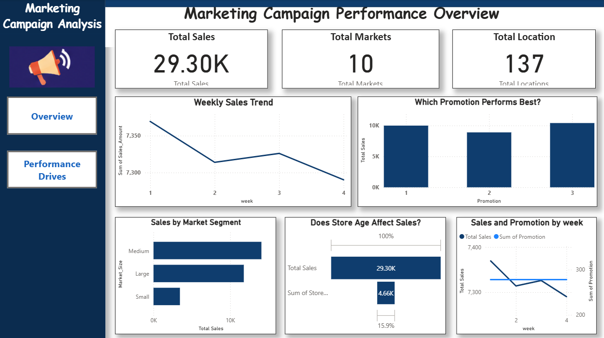

# 📊 Marketing Campaign Analysis

### Exploratory Data Analysis | Data Cleaning | Sales Performance | Data Visualization

## 📌 Project Overview

Marketing Campaign Analysis is a data analytics project that focuses on understanding sales performance across different markets, promotions, locations, and store age groups.

The project uses a real-world marketing campaign dataset containing 548 records and 7 columns. Exploratory Data Analysis (EDA), statistical analysis, and data visualization are performed to identify sales patterns and generate meaningful insights.

An interactive Power BI dashboard is used to present the findings in a clear and understandable format.

## 🎯 Project Objectives

- Understand and explore the marketing campaign dataset.
- Perform data quality checks and preprocessing.
- Identify missing values and duplicate records.
- Analyse sales performance across different market sizes.
- Compare the performance of different promotions.
- Examine weekly sales trends.
- Analyse location-wise and store-age-related sales.
- Explore relationships between numerical variables.
- Create visualizations and a Power BI dashboard.
- Generate meaningful findings and recommendations.

## 📂 Dataset Information

**Dataset:** `Marketing-Campaign_raw.csv`

| Description | Details |
|---|---|
| Total Records | 548 |
| Total Columns | 7 |
| Unique Markets | 10 |
| Unique Locations | 137 |
| Market Categories | Small, Medium, Large |
| Promotions | 3 |
| Weeks | 4 |
| Missing Values | 0 |
| Duplicate Records | 0 |

### Dataset Columns

| Column | Description |
|---|---|
| MarketID | Market identifier |
| MarketSize | Market category |
| LocationID | Location identifier |
| AgeOfStore | Age of the store |
| Promotion | Promotion category |
| week | Week number |
| SalesInThousands | Sales value in thousands |

## 🛠️ Tools and Technologies

- **Python:** Data analysis and preprocessing.
- **Pandas:** Data manipulation and analysis.
- **NumPy:** Numerical operations.
- **Matplotlib:** Data visualization.
- **Power BI:** Interactive dashboard creation.
- **SQL:** SQL queries included in the project repository.

# Marketing Campaign Analysis

### Page 1 – Marketing Campaign Performance Overview



---

### Page 2 – Where Is Our Performance Coming From?

<!-- Add your Page 2 dashboard screenshot here -->


## ⚙️ Project Methodology

### 1. Data Collection
The marketing campaign dataset was loaded from a CSV file.

### 2. Data Exploration
- Checked dataset dimensions.
- Examined column names and data types.
- Generated descriptive statistics.
- Checked missing values and duplicate records.

### 3. Data Cleaning and Preprocessing
- Checked missing and duplicate records.
- Reviewed data types.
- Treated identifier and category columns appropriately.
- Examined potential outliers in sales values.

### 4. Exploratory Data Analysis
Performed analysis to understand:
- Sales by market size.
- Sales by promotion.
- Weekly sales trends.
- Location-wise sales performance.
- Store-age-related sales performance.

### 5. Statistical Analysis
Used descriptive statistics and correlation analysis to explore numerical data and relationships.

### 6. Data Visualization
Created charts to represent sales patterns and communicate important findings.

### 7. Dashboard Development
Developed a Power BI dashboard to display key performance indicators and sales comparisons.

## 📈 Key Performance Indicators

| KPI | Result |
|---|---:|
| Total Sales | 29.30K |
| Total Markets | 10 |
| Total Locations | 137 |
| Total Records | 548 |

## 🔍 Key Findings

1. Medium-sized markets contribute the highest share of total sales, approximately 48%.
2. Large-sized markets contribute approximately 40.2% of total sales.
3. Small-sized markets contribute approximately 11.76%.
4. Promotion 3 records the highest sales among the three promotions.
5. Promotion 2 records the lowest sales.
6. Week 1 records the highest weekly sales.
7. Sales remain relatively stable across the four weeks.
8. The dataset contains no missing values or duplicate records.


## 💡 Business Recommendations

- Study the factors contributing to higher sales in medium-sized markets.
- Review Promotion 3 performance alongside campaign costs and profitability.
- Investigate opportunities to improve Promotion 2 performance.
- Monitor weekly sales trends regularly.
- Compare location-wise performance to identify improvement opportunities.
- Use dashboard insights to support marketing decisions.

## 📁 Project Structure

```text
Task-3-Marketing-Campaign-Analysis/
│
├── Image/
│   ├── dashboard_1.png
│   └── dashboard_2.png
│
├── Marketing-Campaign_raw.csv
├── Marketing-campaign.sql
├── Marketing.ipynb
├── Marketing_Campaign_Analysis_Task_3_Report.docx
└── README.md
```

## 🚀 How to Run the Project

1. Clone or download this repository.
2. Install Python and Jupyter Notebook.
3. Install the required Python libraries:

```bash
pip install pandas numpy matplotlib
```

4. Open `Marketing.ipynb` in Jupyter Notebook.
5. Keep the CSV dataset in the correct project directory.
6. Run the notebook cells to perform data exploration and analysis.
7. Open the Power BI dashboard file if available.

## 📚 Learning Outcomes

Through this project, I gained practical experience in:

- Working with a real-world dataset.
- Data exploration and preprocessing.
- Exploratory Data Analysis.
- Statistical analysis and correlation.
- Data visualization.
- Interpreting sales performance.
- Presenting analytical findings through dashboards.

## 👩‍💻 Author

**Priyanka Das**

Data Engineering Student | Aspiring Data Analyst

---
