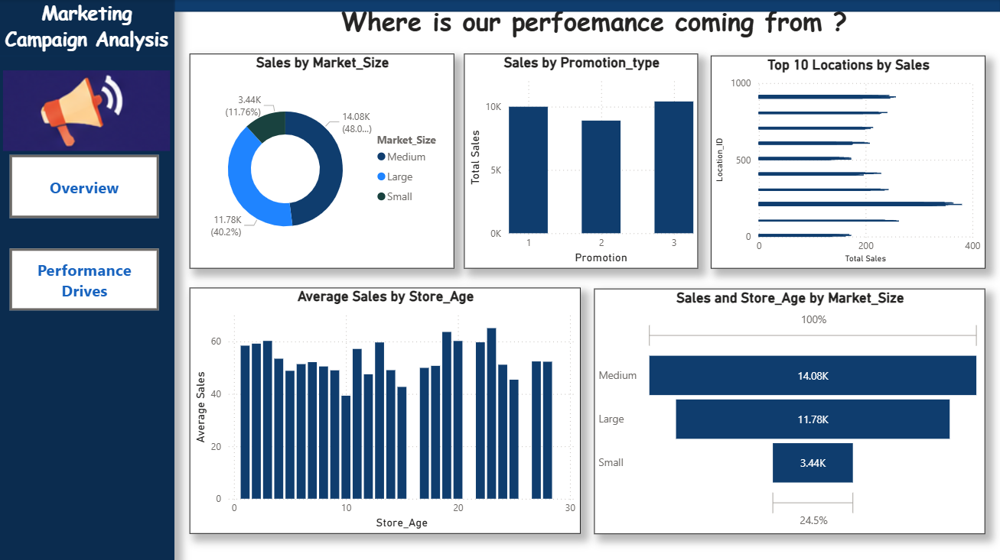

# Marketing Campaign Analysis

## Project Overview
This project focuses on analyzing marketing campaign data to understand customer behaviour, campaign performance, and response patterns. The aim is to explore the dataset, identify meaningful trends, and present useful insights through data analysis and visualizations.

## Objectives
- Explore and understand the marketing dataset.
- Perform data cleaning and preprocessing.
- Analyze customer and campaign-related information.
- Identify trends and patterns using SQL and Python.
- Create an interactive Power BI dashboard.
- Present findings and recommendations.

## Tools and Technologies
- Microsoft Excel
- Python
- Pandas and NumPy
- Matplotlib and Seaborn
- SQL
- Power BI

## Project Workflow
1. Dataset collection and understanding.
2. Data cleaning and preprocessing.
3. Exploratory Data Analysis.
4. SQL-based analysis.
5. Python-based analysis.
6. Dashboard creation.
7. Findings and recommendations.
# Marketing Campaign Analysis

## Project Dashboard

## Project Files
- `dataset/` – Dataset used for analysis.
- `notebooks/` – Python analysis notebook.
- `sql/` – SQL queries.
- `screenshots/` – Dashboard and analysis screenshots.
- `Report/` – Final project report.

## Conclusion
The project demonstrates the use of data analysis techniques to understand marketing campaign performance and communicate findings through visualizations and a dashboard.
